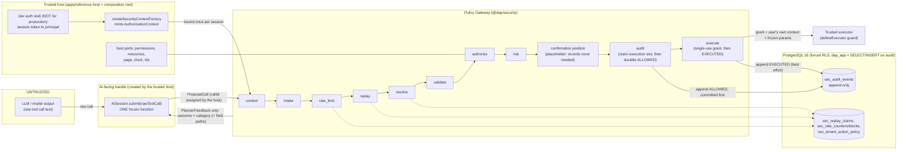

# Architecture and trust boundaries (Feature 001, Milestone M1)

For current authoring and browser integration, see [DAP Studio](./studio-browser-foundation.md).

**Status**: written 2026-11-16 from the code on `dev` (head `e610cf8`) for task T142. Every claim below names the file or test that backs
it. Where a claim is a limit rather than a guarantee it says so; the full list is in [constitution-review.md](./constitution-review.md).
This document makes **no claim that the system is "secure"**. It says which failures are made structurally hard, and how that is checked.

Scope: the **M1 path** only (spec [Milestone M1](../specs/001-ai-security-foundation/spec.md)). The confirmation service, HTTP endpoints,
metrics, multi-replica guarantees and the exhaustive attack catalogue are **not built**; see "What is not here" at the end.

## 1. The M1 path in one picture

Read it left to right. The model's text enters at `submit`; the **only** thing that comes back is `PlannerFeedback`. Identity, tenant, run
metadata, call id, clock and ids are produced by trusted code, never by the proposal.

## 2. Trust boundaries (what is trusted, what is not)

| # | Claim | Where it is enforced | How it is checked |
|---|-------|----------------------|-------------------|
| B1 | The LLM is an untrusted planner. Its output is data to validate, never authority. | Intake reads `raw` exactly once into detached facts (`packages/security/src/gateway/pipeline.ts` `onceProposal`, `stages/intake.ts`); identity-like keys are unknown keys or reserved parameter names (`packages/security/src/registry/reserved-names.ts`). | `tests/security/privilege-escalation.test.ts` (ATK-PRIV-02, claims in parameters and extra keys), `tests/security/prompt-injection.test.ts` (ATK-INJECT-01, 02, 05, literal "I am admin"/"already confirmed"). |
| B2 | Fail closed. Before a confirmed ALLOWED receipt, policy-port faults fail closed. After it, faults preserve ALLOWED and report a failed/unknown execution; optional metadata and telemetry faults do not revoke success. | `wrapHook` (`packages/security/src/gateway/hook-wrapper.ts`), `underDeadline` (`gateway/deadline.ts`), `createPipeline` catches every stage fault (`gateway/pipeline.ts`). | `tests/security/test-world.gateway.test.ts` "a faulted port denies and the executor stays at zero, for each host port"; `tests/security/dependency-failure.test.ts` (hung ports under fake timers). Representative only, not the 36-case matrix. |
| B3 | The Policy Gateway is the only chokepoint. | Three layers: (a) the package graph, below; (b) executors built with `defineExecutor` refuse to run without a grant minted by the Gateway; (c) `@dap/contracts/mint` is importable only by `security` and `testkit`. | `tests/architecture/graph.test.ts` (transitive AI-layer reach walk), `tests/architecture/contracts-boundary.test.ts`, `packages/contracts/src/execution-runtime.test.ts`, `packages/contracts/src/mint/mint.test.ts`. |
| B4 | The AI layer receives one frozen `submit`. It does not receive the registry, executors, stores, pool, audit reader, mint API, confirmation service, or the context it is bound to. | `AiSession` in `apps/reference-host/src/compose.ts`; `forSession(...)` returns a frozen object with a frozen `submit` (`packages/security/src/gateway/submitter.ts`). | `tests/integration/reference-host.test.ts` group "6. the AI-facing handle"; `tests/architecture/graph.test.ts` (public-surface checks: `AiSession` members are `["submit"]`). |
| B5 | The trusted host owns identity, permissions, resources, page, clock and ids. | Ports `AuthenticationPort`, `PermissionChecker`, `ResourceAuthorizer`, `PageContextProvider`, `Clock`, `IdGenerator` (`packages/contracts/src/security-context.ts`, `state-ports.ts`). The context carries **no permissions**; the authorize stage asks the host live (`gateway/stages/authorize.ts`). Page context only narrows. | `tests/security/privilege-escalation.test.ts` (ATK-PRIV-01 parity with the host's own check, ATK-PRIV-06 non-boolean answers deny), `tests/security/review-fixes.test.ts` "AUTHZ-01 / TEST-02". |
| B6 | On the supported AI-facing path, executors are trusted modules reached through the Gateway, with a **single-use execution grant bound to `(requestId, actionId, paramsDigest, tenantId, userId)`**. | `defineExecutor` reads every call field once, verifies the context is minted, consumes the grant in one synchronous block, and runs the body on a frozen snapshot (`packages/contracts/src/execution-runtime.ts`); the grant registry is module-private (`packages/contracts/src/mint/grant-registry.ts`). | `packages/contracts/src/execution-runtime.test.ts` (forged, reused, single-field-mismatch and re-entrant grants), `tests/architecture/graph.test.ts` ("the contracts root cannot expose a private mint value"). |
| B7 | Executors receive the requesting user's own minted context and the validated, frozen parameters, nothing else from the proposal. | `packages/security/src/gateway/stages/execute.ts` header and body. | `tests/security/test-world.gateway.test.ts` "the executor receives the requesting user's own minted context"; `tests/security/positive.test.ts` (POS-01, ATK-PRIV-04). |
| B8 | The AI boundary is an **object-capability** boundary. It is not a sandbox against arbitrary same-process JavaScript. | n/a (a limit) | Stated in `apps/reference-host/README.md` and in [constitution-review.md](./constitution-review.md) "Known limitations". Supply-chain compromise of in-process code can reach the mint functions (plan.md "Remaining Risks" 1). |

## 3. The pipeline, in order

The stage list is `PIPELINE_STAGES` in `packages/contracts/src/core.ts`; the stages are assembled in `assemble()` in
`packages/security/src/gateway/create-gateway.ts`. Before confirmed ALLOWED, a policy-stage failure stops the pipeline. Later faults preserve the committed policy decision and describe the execution outcome.

| # | Stage | What it does (file under `packages/security/src/gateway/stages/` unless noted) |
|---|-------|---------------------------------------------------------------------------------|
| 1 | `context` | Accepts only a minted, unexpired `AuthorizationContext` (`context.ts`). Context denial does not even read the proposal. |
| 2 | `intake` | Strict envelope `{action, params}`, byte and depth caps, duplicate/prototype keys rejected (`intake.ts`, `packages/security/src/validation/`). A malformed proposal is admitted once through the limiter before it is rejected (the review-fix RATE-01 in `docs/review-fixes.md`). |
| 3 | `rate_limit` | `limiter.checkProposal` through the `RateLimiter` port: proposals per turn, chain depth, turn budget, per-user and per-tenant windows, and the denial-throttle block (`rate-limit.ts`, `packages/security/src/limits/limiter.ts`). |
| 4 | `replay` | Claims `encodeURIComponent(aiSessionId):encodeURIComponent(callId)` in the caller's tenant; a duplicate is `replayed_request` (`replay.ts`). |
| 5 | `resolve` | Exact-match lookup in the immutable registry; reserved-forbidden names; global allowlist (default deny) and tenant narrowing (`resolve.ts`). |
| 6 | `validate` | Strict Zod parameters, deeply frozen, with a digest bound to tenant and user (`validate.ts`, `validation/params.ts`). |
| 7 | `authorize` | Session still valid, permission via the host port (only a literal `true` allows), page narrowing, resource authorization; a state change without an extracted resource is refused; the per-capability and HIGH/CRITICAL risk quotas are checked here, after permission (`authorize.ts`). |
| 8 | `risk` | Deterministic: SAFE/LOW continue; MEDIUM continues only with a recorded, bounded (1000 UTF-16 units) opt-out justification; HIGH/CRITICAL and confirmation-required MEDIUM stop at `REQUIRES_CONFIRMATION`; FORBIDDEN is denied (`risk-gate.ts`). |
| 9 | `confirmation` | **Position only.** `createNoConfirmationStage()` records that none was needed. No confirmation record is created and the confirmation service is not built (`risk-gate.ts`, `create-gateway.ts`). |
| 10 | `audit` | Claims one execution slot of the turn (`claimExecution`), then commits the durable `AI_ACTION_ALLOWED` event; if either fails nothing runs (`audit.ts`). |
| 11 | `execute` | Re-proves that every earlier fact agrees, mints the grant, calls the executor, records `AI_ACTION_EXECUTED` (`execute.ts`). The only stage that builds `ALLOWED`. |

`ALLOWED` is a **policy decision**. It is not proof that a side effect happened (see section 5).

## 4. Decision and audit invariants

| Invariant | Mechanism | Evidence |
|-----------|-----------|----------|
| With healthy storage and minted context: one `AI_ACTION_PROPOSED` and one policy decision per proposal, normally followed by an execution outcome for ALLOWED. | `createDecisionAuditor` writes every decision from the runner (`gateway/decision-auditor.ts`); one id per proposal serves as `decisionId` and `requestId` (`gateway/submitter.ts`). | `tests/integration/audit-trail.test.ts` "every request has exactly one PROPOSED and one decision event"; `tests/security/audit.test.ts` ATK-AUDIT-04 on the real Gateway. |
| **Durable `ALLOWED` before every execution** (SAFE included, stricter than spec FR-040, research D13). | The audit stage commits the event with `recordAllowedDurably`; only a *confirmed* append yields an opaque, evaluation-bound receipt the runner accepts (`audit/audit-writer.ts`, `stages/allow-facts.ts`). A rejected, hung, wrong-shaped or late answer is `audit_unavailable` and nothing runs. | `tests/integration/audit-postgres.test.ts` chain A (ALLOWED row committed before the body runs), chain B (real write failure executes nothing); `tests/integration/reference-host.test.ts` group 4; `tests/security/review-probes.test.ts` (receipts cannot be forged or replayed). |
| Per-turn execution cap claimed **before** the allow event. | `limiter.claimExecution` in the audit stage, before `events.make`. Denied and confirmation-required proposals never reach it; the slot is never refunded, even if the executor fails. | `tests/security/execution-cap.test.ts`. Default `executionsPerTurn` is 8 (`limits/limit-config.ts`). |
| No contradictory `DENIED` after a confirmed durable-ALLOW receipt (uncertain COMMIT is qualified below). | Post-ALLOW faults (missing binding, spent budget, hung result write) report `ALLOWED` with a failed execution, never a denial. | `tests/security/review-fixes.test.ts` "LOGIC-01 / TEST-01"; `tests/integration/audit-postgres.test.ts` "QA16 post-ALLOW PostgreSQL evidence". |
| The planner sees only outcome, category and field paths. | `toPlannerFeedback` (`gateway/feedback.ts`); audit values are projected through the capability's allowlist and scrubbed (`audit/projection.ts`, `audit/scrubber.ts`). | `tests/security/secret-extraction.test.ts` (ATK-SECRET-01..04 and the real-gateway block), `tests/integration/audit-postgres.test.ts` P4. |
| Besides explicitly allowlisted parameter values, the attempted action name is model-authored data kept in the trail: escaped to printable ASCII, scrubbed, at most 64 characters. | `packages/security/src/audit/event-builder.ts`. An **empty** attempted name is stored as NULL. | `tests/security/secret-extraction.test.ts` "(1b) a secret-like ACTION NAME ..."; `tests/integration/audit-postgres.test.ts` "AUDIT-01 / TEST-03". |

## 5. Limits of those invariants (read before relying on them)

These are verified against the code and tests; the complete list with owners is in [constitution-review.md](./constitution-review.md).

- **Commit-acknowledgement window.** When the audit writer gives up on an append it aborts that attempt's signal and the PostgreSQL sink rolls
  back if it is aborted before `COMMIT` (`packages/security/src/state/postgres/audit.ts`, `docs/review-fixes.md` "Retained limits"). A `COMMIT`
  already in flight has an uncertain outcome, so an `ALLOWED` row can exist for a request that was denied and never executed. The trail then
  shows `ALLOWED` without `EXECUTED`; an EXECUTED failure records an outcome, not proof that the executor body started.
- **No exactly-once, no cancellation.** A trusted executor that is already running is not cancelled when the proposal budget runs out, and a
  host that retries can run a side effect twice (`docs/review-fixes.md`; `apps/reference-host/README.md`).
- **Recording of `PROPOSED`, non-ALLOW decisions and `EXECUTED` is best effort.** A selectively failing sink can omit them. Complete trails are
  asserted only with healthy storage (`docs/review-fixes.md`).
- **Admission bounds limiter work, not ingress or audit volume.** The 200-envelope malformed flood costs 32 shared-store calls instead of 395,
  but two audit events per proposal are still written (`docs/review-fixes.md` "Independent QA follow-up").

## 6. Package dependency rules and who checks them

Allowed edges (plan.md "Allowed dependency edges"): `contracts` has no workspace dependencies; `ai`, `actions`, `security` depend on
`contracts` only; `testkit` depends on `contracts`, `security`, `ai`; `apps/reference-host` is the composition root.

| Rule | Enforced by | Check |
|------|-------------|-------|
| `ai` cannot reach `security` or `actions`; `actions` and `security` cannot reach `ai` or each other's runtime | dependency-cruiser rules `ai-not-to-security-or-actions`, `actions-not-to-ai-or-security`, `security-not-to-ai-or-actions` in `dependency-cruiser.config.cjs` | `npm run check:deps` (`depcruise ... packages apps`); `tests/architecture/graph.test.ts` plants each forbidden edge in a disposable workspace |
| `contracts` is a leaf | rule `contracts-leaf` | same |
| **Production, including `apps/`, must not import `testkit`** | rule `production-not-to-testkit` (`from: ^(packages/(contracts\|ai\|actions\|security)\|apps)/`) | same; the reference host's manifest does not declare the testkit (`tests/architecture/graph.test.ts` "workspace manifests") |
| Nothing imports `apps/` | rule `nothing-imports-apps` | same |
| **`@dap/contracts/mint` only from `security` and `testkit`**; no deep imports into contracts | rules `mint-entry-restricted`, `no-deep-imports-into-contracts`, plus the ESLint restrictions in `eslint.config.js` (static, dynamic and `require` forms) | `tests/architecture/contracts-boundary.test.ts` (every import form), `npm run lint` |
| **`pg` only under `packages/security/src/state/postgres`** | the production static scan, anchored at the repository root (including `apps/`; dependency-cruiser cannot see external packages, so this is a source scan, not a graph rule) | `tests/architecture/static-scan.test.ts` "pg is allowed only under state/postgres"; `tests/architecture/graph.test.ts` "no import of the database driver" for the host |
| No `eval`, `new Function`, runtime module loaders, shell, global `fetch` or sockets in production code | ESLint rules and the same static scan; dependency-cruiser rule `no-runtime-module-loaders` | `tests/architecture/static-scan.test.ts`, `module-loaders.test.ts` |
| No circular dependencies | rule `no-circular` | `npm run check:deps` |
| The reference host wires trusted pieces in `compose.ts` only; the AI package is imported only by `compose.ts` | architecture test over the real graph | `tests/architecture/graph.test.ts` "the reference host (T131, T136)" |

Real result on this head: `npx depcruise --config dependency-cruiser.config.cjs packages apps` reports 241 modules and 0 violations
(see [validation-report.md](./validation-report.md)).

## 7. PostgreSQL audit design (migration 020)

`db/migrations/020_sec_audit_events.sql`, applied by `db/migrate.mjs` as `dap_owner` only (the script refuses any other role).

- **One row per `AuditEvent`**, field for field, plus a `seq` identity column that only makes the order of events sharing an instant
  deterministic. Closed enums (`event_type`, `risk`, `outcome`, `reason`), length checks, and `params_view` limited to a JSON object of at most
  64 KiB act as a second line of defence; sanitization already happened in the event builder.
- **Append-only, two ways.** `dap_app` is granted `SELECT, INSERT` only (`REVOKE ALL ... FROM PUBLIC, dap_app` first). `BEFORE UPDATE OR DELETE`
  row triggers and a `BEFORE TRUNCATE` statement trigger raise `insufficient_privilege` even for the table owner.
- **Tenant isolation.** `ENABLE` and `FORCE ROW LEVEL SECURITY` with policy `tenant_isolation` comparing `tenant_id` to the transaction-local
  `app.tenant_id` on both read and write. The audit adapter sets it per transaction in its append implementation; reads use `tenant-tx.ts` (`packages/security/src/state/postgres/audit.ts`).
- **Role split.** `dap_owner` owns the tables and runs migrations; `dap_app` (no `BYPASSRLS`, not a member of `dap_owner`) is what the host
  connects as (`db/migrations/000_roles.sql`).
- **Bounded writes.** Each append runs with `lock_timeout` and `statement_timeout` of `writeTimeoutMs` (default 1500 ms) and does not start or
  commit once its abort signal is set (`packages/security/src/state/postgres/audit.ts`).
- **Time.** `occurred_at` is the Gateway clock's instant (milliseconds); PostgreSQL keeps microseconds and finer nonzero fractions are rejected
  rather than aliased. `seq` is an insertion tie-break, **not** commit order across concurrent transactions (plan.md "Remaining Risks" 14).

Evidence: `packages/security/src/state/conformance/audit-migration.test.ts` (append-only, RLS, exact columns; this is ATK-AUDIT-06),
`state-postgres-audit.test.ts`, and `tests/integration/audit-postgres.test.ts` (P1 to P5).

Other M1 tables use the same pattern (forced RLS keyed on `app.tenant_id`, `dap_app` privileges listed per table): `sec_tenant_action_policy`
(010, 011), `sec_replay_claims` (040, 041), `sec_rate_counters` and `sec_rate_blocks` (050, 051), purge functions (060). **There is no
`sec_confirmations` table**: the confirmation store is not built.

## 8. The reference host and its development authentication

`apps/reference-host` is the **composition root**, not an application platform (`apps/reference-host/README.md`).
`composeReferenceHost(env)` (`src/compose.ts`) validates configuration first (`src/config.ts`), builds the registry and executor bindings from the
three demo capabilities (`src/capabilities.ts`), creates the PostgreSQL pool (`createPostgresPool`, strict bounds), wires the PostgreSQL audit,
replay, rate-limit and tenant-policy stores, **fail-closed placeholders** for the confirmation store and channel, a system clock and UUID ids,
then the real Gateway. It returns `{ host, trusted }`: `host` is `openSession(evidence)` and `close()`; `trusted` is the host's own view of its
executors and is never reachable from an `AiSession`.

- **Call ids** are assigned by the host as `aiSessionId.turnId.providerCallId` (`compose.ts`). Each `openSession` starts a new turn, so a host-side
  second `openSession` can re-run a provider call id; within one turn a reused id is a replay. The AI-facing handle cannot open sessions.
- **Demo capabilities**: `demoLookup` (SAFE), `demoSaveNote` (MEDIUM with a recorded confirmation opt-out; the lowest state-changing class, because
  registry rule R6 forbids SAFE and LOW from changing state), `demoPublishNote` (HIGH, stops at `REQUIRES_CONFIRMATION`).
- **Development authentication is a deliberately unsafe stub** (`src/dev-auth/index.ts`, marked NOT FOR PRODUCTION). Sessions come only from
  `DEV_SESSIONS`; startup is refused unless `DAP_ALLOW_DEV_AUTH=1` and always when `NODE_ENV` is production (surrounding whitespace and case are
  ignored); malformed, empty or duplicated session tables fail startup; an unknown or expired token yields no session. It is not an authentication
  system. Evidence: `apps/reference-host/src/startup.test.ts`, `tests/integration/reference-host.test.ts` group 2.
- **End-to-end proof**: `tests/integration/reference-host.test.ts` (six numbered groups plus boundary probes) runs dev auth, submit, the real Gateway,
  the durable PostgreSQL `ALLOWED` row, the trusted executor and the `EXECUTED` row on a real database; every denial, the real database trigger
  fault and the HIGH capability leave the executors at zero calls. `npm run test:m1-gate` requires all six groups and seven pinned cases of them to have passed, and
  also requires the dev-auth startup checks (`apps/reference-host/src/startup.test.ts`) and the pool checks (`packages/security/src/state/postgres/pool.test.ts`).

## 9. What is not here (so no one reads it into the picture)

- **Confirmation service, confirmation store, decision endpoint, channel**: not built. `createPolicyGateway(...).confirmations` is a frozen
  stub whose `decide` always answers `not_valid / not_found` and whose `listPending` is empty (`create-gateway.ts`). The host's store and channel
  placeholders reject every call. A HIGH capability therefore ends at `REQUIRES_CONFIRMATION` and its executor never runs.
- **HTTP endpoints, readiness, metrics, Docker image, Kubernetes, Prometheus, Grafana, tracing, SIEM**: not built (OPTIONAL or FUTURE).
- **The exhaustive attack catalogue runner, coverage gate, automated mutation job, double-run determinism infrastructure, deployed multi-replica stress tests, the 36-case
  dependency matrix**: not built or parked; 76 `todo` tests remain and each is tagged OPTIONAL or FUTURE, which `npm run test:m1-gate` enforces.
- **Production executors** (`packages/actions` is empty) and **production authentication**.
