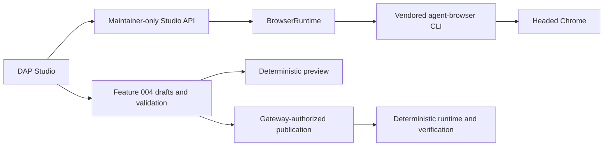

# DAP Studio and the browser foundation

This page documents the browser foundation and its provenance. [Studio V1A](studio-v1.md) describes the current application-aware host.

The foundation added a live browser workspace to the reference-web editor. The editor owned draft authoring. Save and publication used the Feature 004 store, validator, maintainer permissions and Policy Gateway. Preview ran the deterministic engine against the draft from the first step, and the runtime loaded published definitions and verified their postconditions.



The agentic evaluations, including the Qwen experiment, remain on `spike/agent-browser-runtime`. Retrieval is future workflow discovery. Model-assisted authoring and agentic discovery are optional future work.

## Source, license and ownership

| | |
|---|---|
| Upstream | [vercel-labs/agent-browser](https://github.com/vercel-labs/agent-browser) |
| Fork | [Ulmj7/agent-browser](https://github.com/Ulmj7/agent-browser), public, default branch `main` |
| Vendored revision | `v0.43.0`, `1cc19526f3641c8543d55aa6700e7c55b37ac356` |
| Import | Unsquashed Git subtree at `vendor/agent-browser/` |
| License | Apache-2.0 and bundled third-party notices |

The subtree was imported directly from the pinned upstream revision, and its source tree matched upstream byte for byte. This retained the upstream `LICENSE`, the axe-core license and third-party notices. The Studio adapter uses the native executable built from the subtree. It has no global executable or npm-distributed agent-browser fallback.

**Verified fork provenance (2026-11-22).** GitHub REST metadata for `Ulmj7/agent-browser` reports `fork: true`, `parent` and `source` both `vercel-labs/agent-browser`, public, default branch `main`. Fork `main` is `d2dfc782…`, identical to upstream `main`. The vendored commit `1cc19526…` is an ancestor of fork `main`, so the fork can supply the exact vendored source. The fork has no `v0.43.0` tag. GitHub does not copy tags to a fork, and upstream still provides it. The vendored tree has not changed since the import commit `444fa8a4`; the import's `git-subtree-split` is `1cc19526…`. Nothing has been pushed to the fork, and DAP still pins `v0.43.0`.

**Local remote.** A fetch-only remote named `agent-browser-fork` points to the fork. Its push URL is deliberately invalid, so it cannot receive a push, and it does not fetch tags. It has no effect on `origin` (`Ulmj7/Simplism-DAP-`). It is local clone configuration and is not committed. To recreate it:

```bash
git remote add agent-browser-fork https://github.com/Ulmj7/agent-browser.git
git config remote.agent-browser-fork.pushurl DISABLED_NO_PUSH
git config remote.agent-browser-fork.tagOpt --no-tags
```

**Future unsquashed sync.** The steps below are not done and not needed for this milestone. Each one is performed on an isolated DAP branch. Do not use `--squash`, because the upstream history in the subtree must be retained.

1. Fetch the fork: `git fetch agent-browser-fork main`. To pin to an upstream release, also fetch its tag from `vercel-labs/agent-browser` and confirm that the tagged commit is an ancestor of `agent-browser-fork/main` (`git merge-base --is-ancestor <tag-commit> agent-browser-fork/main`). A fork that is behind upstream must be synced on GitHub first (**Sync fork**, or a push from a separate clone, which needs separate authorization).
2. Choose a reviewed commit SHA rather than the moving branch tip. Review `git diff HEAD:vendor/agent-browser <sha>` for license, notice and dependency changes.
3. Merge it with `git subtree pull --prefix=vendor/agent-browser agent-browser-fork <sha>`, without `--squash`.
4. Rebuild the native binary and rerun the DAP integration gates and the Studio smoke tests before integration.

Optional and not yet done: a `dap-vendor` branch on the fork for Studio-specific vendor patches, which requires push authorization on `Ulmj7/agent-browser`. Vendor changes needed for Studio should first be committed and tested on the fork. npm, TypeScript, DAP lint and DAP test discovery retain their original workspace boundaries.

## Build and use

Build from the DAP root and install an appropriate Chrome runtime if needed:

```bash
npm ci
npm run build:agent-browser
vendor/agent-browser/cli/target/release/agent-browser install
vendor/agent-browser/cli/target/release/agent-browser doctor
```

The native build uses the vendor Cargo lockfile and writes to the ignored `cli/target/` directory. The Linux proof built with `rust:1-bookworm` in Docker and used the resulting host executable. Vendor edits are unnecessary for this milestone.

Follow the [Feature 004 quickstart](../specs/004-authoring-analytics/quickstart.md) to configure PostgreSQL, the maintainer demo session and authoring permissions. Enroll the application with its primary origin, allowed origins and registry before connecting the browser. See [Studio V1A](studio-v1.md) for enrollment and the manual registry picker fallback.

## Browser and workspace boundaries

The maintainer-only Studio API binds one Chrome session per host to the principal, tenant, actor, enrolled application and opaque session ID. The selected registry supplies approved pages and accessibility labels. Enrollment supplies the allowed origins. The vendored CLI allowlist operates at the hostname level. The adapter reads the accessibility snapshot locally and checks the exact origin and supported route before returning filtered candidates. Highlight and Use re-check the current observation against the selected application's registry. Saved steps carry registry IDs.

Disconnect, five minutes of inactivity and host shutdown trigger session cleanup. Removing, disabling or changing the browser policy of an application triggers cleanup on the next inspection command. See [Studio V1A](studio-v1.md#browser-session-and-inspection) for the current inspector and session behavior.

## Verification

Run `npm run test:studio` for the focused suite. Both acceptance commands passed three consecutive headed Chromium runs. The UI command also passed without a display. [Run the host and editor acceptance checks](studio-v1.md#verify-with-chromium)

| Command | Host-only acceptance | UI run, host handling | UI run, click to observed result |
| --- | ---: | ---: | ---: |
| Connect | 1,284–2,993 ms | 1,182–3,163 ms | 1,240–3,267 ms |
| Inspect | 9–22 ms | 11–21 ms | 120–131 ms |
| Highlight | 13–20 ms | 19–23 ms | 116–123 ms |
| Use | 14–19 ms | 18–23 ms | 114–125 ms |

Routine inspection returned 1–5 candidates in these runs. A separate refresh of the second application's dense page returned 64 candidates in 138 ms at the host and 226 ms from click to observed result with Chrome already connected. These are local observations. UI measurements include operator commands used to observe the result.

The editor acceptance enrolled two applications, verified a Chrome outline with no draft write, used target IDs, completed Preview and the published guide, switched applications and recovered from blocked origins. It checked that editor exit closed the browser session. Each run returned browser sessions and owned live processes to baseline and released the acceptance ports.

The foundation-era Chromium proof captured Profile, Display name and Save in one owned Chrome session from a separate Studio session. It saved and reopened a draft, completed Preview, published the draft and completed the guide as an ordinary user. It also verified that exiting the editor closed the browser session. In that run, connection took 3,479 ms and capture took 242–245 ms including operator commands. Preview completion took 440 ms including operator commands and the application save. These timings are from one foundation-era run. Separate diagnostics passed 10 checks and the vendored browser refused a probe to `example.invalid`.
