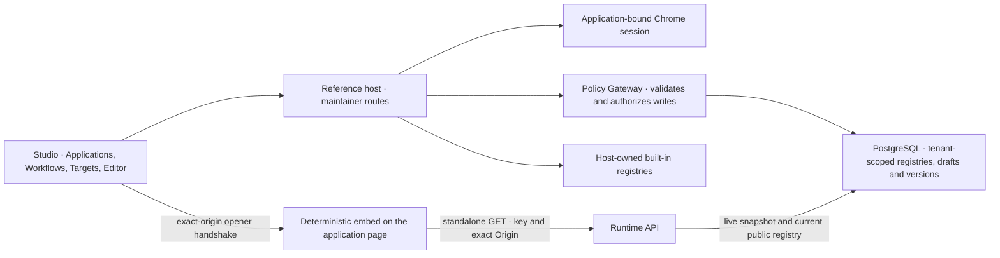
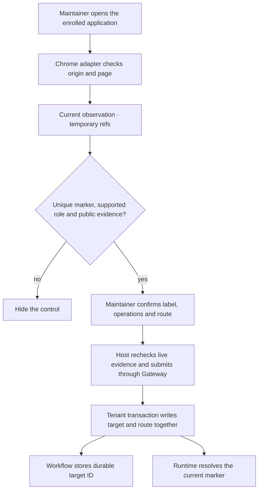

# DAP Studio guide

Studio is the maintainer workspace for building deterministic walkthroughs. Enroll an application, record public targets from its live page, author a workflow, and publish an immutable version. The application can then run the guide using the current registry. Start with the [nine-step quickstart](studio-quickstart.md) or read about the [pinned browser foundation](studio-browser-foundation.md).

## How the parts fit together



## Enroll an application

In **Applications**, add a name, primary origin, permitted origins, environment and registry. Use a plain-text name of up to 80 characters and one to five distinct allowed origins including the primary origin. Use an origin such as `https://orders.example.com` with an explicit port if needed. An origin has no path, credentials, query or fragment. The host accepts HTTPS DNS origins and permits HTTP on `localhost`, `127.0.0.1` and `[::1]` for local work. The available environment labels are **Development** and **Test**. Enrollment allows up to 20 applications per tenant.

- **Built-in** uses a host-owned catalog such as the reference app. Its pages, approved labels, targets and named postconditions come from host configuration. It uses hash routing and runs in-app Preview where supported. Targets are read-only in Studio. Standalone runtime delivery is unavailable.
- **Studio-managed** starts with an empty registry. Recording a target can create a route, and the application can have its own verification checks and runtime delivery key. Registry source is fixed at enrollment.

Choose the application's actual routing model before recording pages.

| Routing | Recorded page key | Example |
| --- | --- | --- |
| Hash | Root `/` or a hash route under the root | `/#/orders` |
| History | Concrete pathname with no query or fragment. A trailing slash is removed except for the root. | `/users/123` |

Hash page keys support up to 120 characters. History paths support up to 200 characters using letters, digits and `._~/-`, with no empty or dot segments. Each concrete path is separate, so `/users/123` does not cover `/users/456`. History playback uses `pushState` and `popstate` with a pathname poll while a guide runs. The app must handle these same-document route changes. A server-rendered navigation or full page reload can end the run. Routing is locked after the first route is recorded.

Use the overview to see registry, target health, draft and live workflow counts. Choose **Open Studio**, **Manage Targets** or **Manage Workflows** to work in the selected application.

## Inspect and register targets

Add unique, stable `data-ai-id` markers to the public elements you want to guide. For example, mark an Orders button with `data-ai-id="orders.submit"`. The dotted ID may contain up to 80 characters, starts with a lowercase letter and uses letters and digits within the segments. The prefixes `dap`, `studio`, `admin`, `system` and `internal` are reserved.



1. Choose **Connect Chrome**, browse to the page in the separate window, then use **Inspect current page** in Studio.
2. **Highlight** locates a listed control in Chrome. Select **Register target…** on a registrable row. Give it a plain-text label of up to 80 characters, a description of up to 240, and role-appropriate operations. Every target includes `highlight`.
3. A new page needs a route name such as `orderList`. Route names start with a lowercase letter, use letters and digits, and have at most 40 characters. A recorded page keeps its route. Each managed application can hold 20 routes and 200 targets.
4. **Use** binds the current guide step to a trusted, active target. You can also select an existing target from the editor's registry picker when Chrome is unavailable.

A new target's durable ID starts equal to its marker. The live ref, such as `@e1`, is temporary and cannot be saved in the workflow. A trusted row matches the current marker, route and role. A mismatched row exposes an active target whose eligible control is now on a different route or has a different role. Disabled targets do not become usable until re-enabled.

| Live role | Stored role and operations |
| --- | --- |
| Button, link, checkbox | Same role. Highlight, with click or focus where selected. |
| Textbox, searchbox | Textbox. Highlight, with input or focus where selected. |
| Combobox | Select. Highlight, with click or focus where selected. |
| Heading | Heading. Highlight only. |
| Status, alert, or implicit `output` | Text. Highlight only. Mark the region and give it visible text. The adapter supplies observation-scoped refs for eligible regions because the pinned CLI does not supply native interactive refs for them. |

### Privacy and observation limits

Managed inspection checks at most the first 64 elements of the bounded observation. The adapter can collect up to 512 elements and discovers up to 32 marked text regions within that overall limit. Duplicate markers among inspected elements hide every matching candidate, even a match that would independently be private. A duplicate outside the inspection window may be missed. The embed separately requires a unique marker in its own DOM when resolving a target.

The registration gate checks public evidence and visible names, including for previously registered targets. Blank or secret-looking names, unreadable facts, explicit ignore/private/redact attributes, password and hidden inputs, and sensitive autocomplete types are excluded. Apply `data-ai-ignore`, `data-ai-private` or `data-ai-redact` directly to sensitive controls. Inspector facts do not propagate an ancestor's ignore marker. The embed checks ancestor ignore separately when resolving targets or evaluating checks.

The name filter normalizes case, Unicode compatibility forms, spacing and invisible format characters. It checks whole words such as password, passcode, API key, card number and OTP. Longer names also match after stripping punctuation and spacing, and four short names (CVV, CVC, SSN, OTP) match in that form only as the entire name. It can hide ordinary names such as “Secretary” and miss other languages, look-alike characters or names that reveal nothing about the data. Use clear public markers and direct privacy attributes. Hidden candidate names and live comparison values do not appear in Studio replies.

## Browser boundary and session recovery

The vendor's Rust and injected JavaScript filters allow hostnames. The adapter separately checks the exact scheme, host and port and the permitted page before releasing observations or using browser evidence. Chrome may reach a different port on an allowed hostname. Local browser output can be collected before its origin is checked and is discarded if out of policy. This boundary filters Studio's evidence and does not replace network isolation.

A host has one Chrome session with one command in flight. The session is bound to the owner, tenant, principal and enrolled application. Navigate to the intended page and inspect again if the ref is stale or a control changed. After a reload, **Reconnect** can adopt the same owner's session for the same application and replaces the old session ID. **Disconnect**, host shutdown and a five-minute idle timeout close the session. Rejections by another caller do not renew it.

## Manage health and repair targets

On **Targets**, select the application and open a target's detail. You can see its durable ID, current marker, health, revision, usage and change history. **Check targets on this page** compares active targets for the current route with the inspected markers, roles and privacy evidence. It can report a missing, ambiguous, changed-role or private control. Inconclusive observations can leave health unchanged. There is no background monitoring.

A broken or unverified target can still be eligible for publication as a warning. Disabling a target removes it and checks that depend on it from validation and runtime bundles. A published guide with such a dependency disappears until its live definition validates against the current registry again.

To repair an active target, choose **Repair…**, open its recorded page, inspect, then choose a replacement. A Preview result can take you to the same repair workflow. The dry run shows the proposed marker, role, operations and text, plus the impacted drafts and live publications. Confirm only when the impact says it is compatible. The host rechecks live evidence and compatibility at commit, even when a workflow has a newer working draft alongside its live version. Repair preserves the durable ID and route, updates the marker binding, marks the target healthy and records the revision. Disabled targets and checks remain in history.

## Author, verify and preview

Choose **Open Studio** on an application or **New walkthrough** in **Workflows**. Supply a title, description and completion message. Add, select, duplicate or reorder guide steps, then choose the target, interaction and instruction for each one. The application is fixed after binding. Use **Save draft** before leaving or reviewing publication. A stale save shows a conflict. Your local edits stay visible, and you can choose when to reload the current server version.

For a managed application, choose a condition under **Verification**, fill in its route, target or expected value as needed, and select **Set verification**. Existing `route.<route>` postconditions continue to work. Built-in applications use the named checks supplied by their catalog.

| Check | What it evaluates |
| --- | --- |
| Route equals | The registered route is current. |
| Element visible or hidden | The marker's element is visible, or the marker is absent or hidden, respectively. |
| Text equals | A visible non-field target’s text content and the expected string match after trimming. Use a value check for a textbox, select or checkbox. |
| Value equals | A public textbox, select or checkbox matches the expected value exactly. For a checkbox use `true` or `false`. |
| Attribute equals | The value of an allowed attribute matches exactly. Options are `aria-checked`, `aria-expanded`, `aria-selected`, `aria-pressed`, `aria-disabled`, `aria-current`, `disabled` and `checked`. The last two use Boolean text. |

Checks are fixed data, evaluate locally in the embed and are deduplicated by content. There are up to 100 per managed application. Use short public expected text, up to 120 characters or 40 for attributes. Do not enter secrets. Expected values are stored and sent in public bundles. Actual comparison values stay in the page.

**Preview** always starts at step 1 and shows position, target, interaction and verification while the workflow runs. A result can identify a missing target, wrong route, failed check, timeout or cancellation. Use **Restart Preview** to repeat the run or **Edit** on **Preview results** to return to the draft. For built-in Preview, dismiss the run's overlay result before selecting **Edit** on the editor result panel. Preview neither publishes nor records normal run usage.

## Review, publish and compare versions

Save the draft, select **Publish** and inspect the review. Blocking items include a disabled application, missing metadata, unavailable targets or checks and incompatible interactions. Broken or unverified targets, missing optional verification and replacement of a live version appear as warnings. Publishing from Studio sends the revision reviewed in the dialog. If another session saves a newer draft, review that revision before publishing.

A successful publish creates an immutable version and makes it live. **Create draft from published** lets you edit without interrupting the live guide. **Version history** shows which version is live. Compare saved versions or a version and the draft to see metadata, step, target, interaction and verification changes. **Create draft from this version** copies the selected historical definition into the working draft. It leaves the current live version in place. Publish to release the restored content as a new version, or **Unpublish** to remove the live version without deleting history.

The host validates publication inside a tenant transaction with workflow and application locks. It validates the exact working revision against the current registry. Published reads serve the immutable live definition and revalidate it against that same application's current public registry, which may have changed since publication.

## Preview and run a managed guide

Run `npm run build:embed`. Serve **both** `dap-embed.js` and `dap-embed.css` from `apps/reference-web/dist-embed/` in the same directory. The installer loads the CSS next to the script. The loopback development API does not serve these assets by itself.

For managed Preview and launching from the authenticated Studio dashboard, put the embed on the application page with the exact Studio **web** origin in `data-dap-origin`.

```html
<script src="/dap-embed.js" data-dap-origin="https://studio.example.com"></script>
```

Start a managed draft’s Preview from **Editor**. Studio opens the enrolled primary origin. Install the embed on the landing page and make the first step’s target reachable from there. The two windows verify each other's origin and window reference, then exchange the draft or live bundle and report diagnostics. The browser must allow the popup and keep the opener relationship. A policy such as COOP that severs the opener also prevents the handshake. Use this mode with an application you trust, since opening it grants an opener reference. An embed configured for both modes prefers the handshake when opened by Studio.

### Standalone runtime delivery

In **Applications**, edit the managed application and enable **Runtime access**. Copy its public key and embed line from the overview. Serve the assets on the origin that exposes the runtime API, or self-host them and set `data-dap-api` to the API origin. Use a runtime API origin distinct from the application page origin so the browser sends the required `Origin` header on the GET requests. Use the real asset and API URLs if the overview's default same-origin snippet does not match your hosting setup.

```html
<script src="https://dap.example.com/dap-embed.js" data-dap-key="REPLACE_WITH_RUNTIME_KEY"></script>
```

For example, with the files hosted directly by the application and the API on a different origin:

```html
<script src="/dap-embed.js" data-dap-key="REPLACE_WITH_RUNTIME_KEY"
        data-dap-api="https://dap.example.com"></script>
```

Load the application directly at an allowed origin. When at least one live guide is available, choose **Guides**, then **Start**. This mode needs neither an opener nor a Studio login. The page can also use `window.DapEmbed.list()` and `window.DapEmbed.start(guideId)`. The API uses credential-free CORS for the exact enrolled page origin and serves live versions only. Missing or wrong browser origins are refused, and an unknown key, disabled application or unavailable guide does not return content. Replies are uncached. The reference host rate limit is 60 requests per minute per key and IP. Disabling runtime delivery or rotating the key stops future requests using the old configuration. Update every embed that used a rotated key.

**Treat published standalone content as public.** The key is a public application identifier and Origin/CORS is a browser delivery boundary, with no end-user authentication. Any visitor who can load the allowed application can read its published guide bundles. Use public guide instructions, labels, descriptions and check expectations. Studio's maintainer routes retain their own authentication, Gateway permissions and tenant isolation.

### Content Security Policy

The embed uses an external stylesheet and positions the overlay through CSSOM. It does not need `'unsafe-inline'` or an inline style nonce. For assets and API on one external origin, an application can start from this header and add the sources its own page requires.

```http
Content-Security-Policy: default-src 'none'; script-src 'self' https://dap.example.com; style-src 'self' https://dap.example.com; connect-src https://dap.example.com; img-src 'self'
```

With split hosting, allow the asset origin in `script-src` and `style-src`, and the API origin in `connect-src`. Keep the actual scheme, host and port in your enrollment and embed configuration. A production reverse proxy or asset host must expose the two files and the runtime API on their advertised origins. The reference development host listens on loopback.

## Verify with Chromium

The completion acceptance script exercises the real Studio UI on an isolated host, browser and fixture set. Coordinate the isolated ports before running it and reuse only the dedicated acceptance database. The plan mode does not start a browser or service.

```bash
node scripts/studio-complete-ui-acceptance.mjs --plan
DAP_ACCEPTANCE_DB_PORT=54362 npm run acceptance:studio-complete-ui -- --run
```

Use `--headless` after `--run` when a display is unavailable. See the [browser build instructions](studio-browser-foundation.md#build-and-use).
